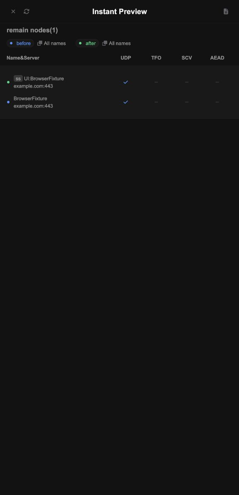

# 免费方案改造与验证记录

日期：2026-10-14。实现保留 `SubscriptionStore`、`substore-sqlite-v1`、`official-v3`，不新增付费平台绑定。

## 已实现

- 官方脚本入口接入 QuickJS/WASM：节点操作、过滤、快捷脚本、异步 HTTP、远程脚本、响应与文件脚本。显式桥接 lodash、YAML、Base64、基础 Buffer、官方数据工具及请求内共享 context；支持 context.process 控制后续操作。
- 脚本资源限制：256 KiB 用户脚本（官方快捷/覆写包装后求值源码 512 KiB）、16 MiB guest 内存、256 KiB 栈、三秒异步期限、累计执行中断及 host 调用限额。异常不再被通用快捷脚本回退吞掉。
- 前端根据能力字段展示脚本动作；原生 cron 输入启用，并展示时区/频率限制；同步页可读取任务状态。
- Artifact 沿用官方 HTTP 同步实现；DO Alarm 安排最早到期任务、持久化状态、有限重试与移除任务。默认 UTC，可配置 IANA 时区；上限 50 个任务，最小间隔五分钟。
- HTTPS 模板/webhook 通知采用持久化待发记录、有限重试与 backlog 上限；没有配置通知 secret 时不发送。
- 官方日志脱敏，启用后最多 500 条；失败请求仅保留诊断日志，不提交它的业务状态变更。
- 请求结束/超时取消上游 fetch，拒绝迟到写入；每次请求最多 40 个 fetch，最多四个同时下载。
- 原 preferences 单值兼容；超过 1.9 MB 后按 Unicode 码点分块，事务提交，上限 4 MiB。备份请求上限 8 MiB。
- CI 增加固定后端重新生成一致性检查、官方原生脚本对比及独立后台/重启验收。

## 已完成的本地验证

- TypeScript 检查和完整官方前端构建。
- 真实 workerd 合同测试：权限、分享过期/撤销/次数并发、订阅与集合、六种导出、备份恢复和并发持久化。
- 脚本成功/失败路径：操作、过滤、异步、快捷脚本、文件、响应头/响应体、死循环、超内存、非法返回、Node require 拒绝与上下文隔离。
- 与锁定官方源码在 Node 上执行的跨平台原生脚本对比：异步操作、过滤、快捷脚本、编码、source 与 context.process。该检查不是完整官方 Node 服务的所有 API 对比。
- 独立 Miniflare/workerd 后台验收：模拟 GitHub HTTP 接收实际转换内容、Alarm 同步、guest 异步 HTTP、远程脚本、通知失败重试、重启后任务与分块数据恢复、删除 Artifact 后取消任务。模拟接收端不等于真实 GitHub/webhook 投递。
- 浏览器原生编辑器：脚本动作可见，代码输入与预览成功显示 `UI:BrowserFixture`；同步页读取状态成功；原生 cron 输入可编辑并显示 UTC/五分钟提示。
- 本地 100 / 1,000 / 5,000 节点预览和脚本通过；一次测量墙钟约 28 / 52 / 153 ms。数值随本地负载变化，不是线上 CPU、冷启动或免费额度证明。
- Wrangler 仅进行本地 dry-run，验证 JS/Text/WASM 打包，无远程部署。



## 保留的边界

全局请求队列保留，确保官方 JSON 数据和分享令牌次数的原子性；未实现快照版本校验后的并行预览。慢任务仍可能影响同一安装内其他请求。分块解决单行容量，不消除全量 JSON 的解析成本。

Buffer 是基础子集，host 回调/任意 require/本地文件/原生扩展/MMDB/客户端代理策略未支持。日志默认遵循官方设置，`logsMaxCount=0` 时关闭。cron 频率验证检查接下来一组触发间隔；不是任意时间跨度的数学证明。

Alarm 至少执行一次；同步与通知的外部副作用不能保证恰好一次。有限失败重试完成后 Artifact 等待下个正常周期，通知记录变为 failed。免费额度是账户共享的，未接入账户实时额度查询，也不承诺额度耗尽后可持续服务。

尚未验证：生产版本/数据、真实账户套餐与免费额度、远程 CI、线上冷启动/CPU/duration、实际 GitHub 或 webhook 投递、Loon/Mihomo 等真实客户端导入更新。没有提交、推送或部署。

回滚必须使用支持分块的适配器或经验证的备份恢复流程，详见 DEPLOY.md；旧适配器会对已分块的数据明确失败。

## 重复验证

```sh
node scripts/build-official-backend.mjs
# 前端按锁定版本构建
node scripts/sync-official-frontend.mjs
cd worker
npm ci
npm run typecheck
cd ..
WORKER_TEST_NATIVE_PARITY=1 node scripts/test-worker.mjs
cd worker
npm run test:background
```

网络受限时，可通过 `FRONTEND_SOURCE` 或 `SUBSTORE_SOURCE` 指向已验证的固定版本源码镜像；`.source-lock.json` 记录版本和 Git blob SHA-1，构建会逐文件核对。此镜像只用于构建，没有替换上游版本。
