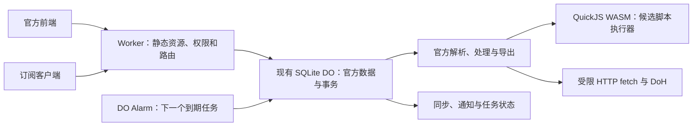

# Cloudflare 免费方案下增强 Sub-Store 的实施方案

日期：2026-10-14。用户约束：必须保持 Cloudflare 免费方案。

实施记录：[免费方案改造与验证](free-plan-implementation.md)。以下保留原方案；当前已实现范围和未验证项以实施记录为准。

## 决策

保留官方前端、官方解析/转换/处理逻辑和 SQLite Durable Object，补齐 Workers 平台适配。优先验证 QuickJS/WASM 脚本执行，再完善 Artifact 同步、Alarm 定时任务、HTTP 通知和日志；按实际容量压力改进持久化。

目标是覆盖个人使用中常见的完整版功能，不能承诺任意 Node 脚本、原生依赖、客户端代理策略或无限数据规模。

不采用 Dynamic Workers、Containers、付费升级、VPS 或外部常驻执行服务。免费额度耗尽时应明确报错或暂停后台任务，不能自动切换付费资源。

## 证据与当前基线

本方案检查了本地源码、现有验收脚本、锁定版本的部分官方源码，以及 Cloudflare 当前文档。没有检查账户真实套餐、线上部署版本、线上数据、浏览器行为或实际额度；“当前”以下均指本地实现。

- 后端锁定官方 2.42.3 / `a3e61061e50b40e5c5938969aab915d05d8d7069`，前端锁定 `4bd7b0acbe65466b933ccea14fc61dbebe036ead`。
- `worker/src/index.ts` 使用 `SubscriptionStore` / `official-v3`，读取 preferences 全表，启动独立官方运行时，成功后事务提交变更。全部请求进入同一 Promise 队列。
- `scripts/build-official-backend.mjs` 使用官方跨平台代理运行时，将 Node 部分模块替换为空实现，强制非 Node 环境；构建后把所有 `eval` / `new Function` 替换为拒绝执行。
- `scripts/patch-workers-frontend.mjs` 根据 `CloudflareWorkers` 名称隐藏 Script / Response Transformer 操作，并显示固定限制提示。
- `$notify` 是空实现，请求 console 方法也是空实现。官方自身的日志路径需单独验证，不能据此认定 `/api/logs` 完全无内容。
- 下载/请求体上限 1 MiB，持久化单值上限 1,900,000 字节；请求运行时超时 25 秒，上游 fetch 超时 20 秒。这些是本项目的限制，不是 Cloudflare 对所有同类操作的统一限制。
- Wrangler 没有配置 cron，类没有 `alarm()`，因此没有当前安装的后台调度能力。
- `tests/contract.mjs` 覆盖管理权限、分享令牌、CRUD、内置处理、六种导出、集合、本地文件、备份恢复、并发写入、远程 HTTP 订阅和脚本拒绝。对 settings/artifacts/logs 的列表读取不能证明完整配置、实际上传或日志功能通过。

## 功能目标

| 功能 | 当前证据 | 免费方案目标 |
| --- | --- | --- |
| 订阅、集合、内置节点处理和格式转换 | 已有实现与合同测试 | 继续复用，扩大协议和输出语义样例 |
| 自定义 Script Operator / Filter | 明确拒绝 | QuickJS 小范围验证后，逐类启用 |
| Response Transformer、文件脚本 | 明确限制 | 前两类稳定后再验证，不与节点脚本捆绑承诺 |
| Artifact 手动同步与定时同步 | 有官方路由，后台调度缺失 | 先验证真实 HTTP 上传/同步，再接 Alarm |
| HTTP 通知 | `$notify` 空实现 | 接入官方兼容的 HTTP 模板或 webhook；按配置启用 |
| 日志与任务状态 | console 被丢弃，日志路由存在 | 脱敏、限量保留，前端可读失败原因 |
| 文件、远程资源、备份 | 基本能力存在，受体积限制 | 分类限额，兼容官方备份，必要时分块持久化 |
| GeoIP / MMDB | Node 文件路径受限 | 后续可选实验，先保留已有 DoH/地区处理能力 |
| 本地任意路径、Node require、原生扩展、进程和代理策略 | 无完整运行环境 | 明确标记不支持，不静默当成成功 |

## 架构

第一版不新建 D1/KV/R2，不按订阅分片，不并存两套权威数据。保留现有 DO 类、迁移记录和对象名，避免部署变成空安装。

普通 Worker 与 DO 的限额需要分别核对：Workers Free 的 HTTP CPU 文档为 10 ms，DO 文档给出独立的调用 CPU 限制；不能把 10 ms 简单套用到整个现有 DO 执行流程。重计算优先留在 DO 中，实际可用性仍以免费测试环境测量为准。

## 阶段 0：能力与验证基线

交付：可核验的功能矩阵、免费额度预算、样例数据和按能力控制的前端。

1. 扩展现有 `/api/utils/env` 的能力信息，分别描述节点脚本、响应脚本、调度、通知、文件等。优先沿用官方已有字段；扩展字段仅在需要时增加。
2. 前端读取能力决定显示/禁用与原因，替换按后端名称统一隐藏的规则。导入的旧脚本继续可见、可编辑；不支持的能力明确提示。
3. 给上游源码改写增加预期匹配次数、入口/依赖清单和生成检查，避免上游更新后替换失效仍部署。
4. 对比锁定官方 Node 后端与本项目，记录同一数据的预览、导出、错误、文件和备份结果；不以“路由返回 200”判定兼容。
5. 使用独立免费测试安装验证预算，不用生产安装做全量恢复实验。

完成条件：前后端能力一致，现有行为无回退，所有后续阶段都有明确的测试样例和额度预算。

## 阶段 1：脚本可行性与逐步启用

这是决定本方案能否显著接近完整版的首要技术门槛。

先使用维护中的 `quickjs-emscripten` release 变体做最小试验：静态打包 WASM，通过正式 Worker/DO 加载方式执行最简单的重命名和过滤脚本。项目官方提供 Workers 示例，但其示例验证版本较旧，仍需用本项目 Wrangler 验证。

实现路线：

- 在官方 `createDynamicFunction` 及对应调用边界接入执行器。保留运行时中 Node 专用 eval 的拒绝策略，不把所有 eval 一律转交解释器。
- 先支持纯数据 Script Operator，再支持返回过滤结果的 Script Filter，随后验证异步脚本、远程脚本和 Response Transformer/文件脚本。
- 显式传递 proxies、目标平台、`$arguments`、context/source 等实际官方参数；桥接 `$substore`/工具函数时逐项核对语义。WASM 上下文不能自动捕获原运行时的 JS 闭包。
- 为 guest Promise 建立 pending-job 驱动和 host 异步桥接；HTTP、编码和数据工具按需要暴露。不将整个 env、管理 secret 或存储绑定交给脚本。
- 脚本需要持久化时，通过受控接口暂存本次变更，再随原事务提交；不绕过订阅及分享权限。
- 设置解释器内存、栈、执行中断、网络超时、子请求次数、输出体积上限，并在每次执行后释放 context/handles。
- 远程脚本可缓存内容和校验值，但运行期可变全局状态不跨请求共享。

验证：同一脚本与官方 Node 结果对比；覆盖异步结果、异常、死循环、超内存、host fetch 超时、非法返回、Unicode、连续多次执行和跨请求隔离。分别测冷启动、热请求 CPU、内存、WASM/部署体积与 DO duration。

建议样例规模为 100 / 1,000 / 5,000 个节点，逐级测量，不把这些规模提前宣称为支持上限。

通过条件：代表性用户脚本在免费环境稳定运行，异常可中断、状态不损坏、成本受控。失败则保持脚本能力关闭，继续后续可独立落地阶段；不能以本地 Node 中能运行 QuickJS 替代 Worker 验收。

## 阶段 2：Artifact、调度、通知与诊断

先验证官方同步实际执行路径及所需设置，补齐 HTTP(S) 上传、认证和失败反馈；只有 CRUD 的 Artifact 记录不算完成同步。

调度复用官方 cron 字段和规则；官方当前校验与 CronJob 启动依赖 Node，需替换为 cron 下次触发时间计算和 DO Alarm：

- 保存任务配置、nextRunAt、状态和执行记录，每个对象只安排最早到期的一次 Alarm。
- 保持 cron 字段/秒字段/时区的明确兼容范围。默认时区必须明示；不能将已有规则静默按新时区解释。免费方案限制过高频率并给出配置错误。
- `alarm()` 领取到期任务，执行后安排下一次。新任务、修改、删除和恢复备份都必须重算 Alarm。
- Alarm 至少执行一次，故使用“任务 + 计划触发时间”的执行标识、持久化状态、有限重试和退避。外部上传/通知如果不支持幂等键，明确可能重复，不能声称 exactly-once。
- 不让 Alarm 在持有同一队列锁时再次调用公开 `handle()` 而自锁；先提取可供请求/Alarm 共用的实际执行路径。
- 第一版使用持久化任务表，不额外引入队列产品。每次执行有批量上限，限制重试并允许停用。

通知先支持 HTTP 模板或通用 webhook，并明确与完整 Node Shoutrrr 支持范围的差异。通知失败独立记录，不回滚已成功的订阅更新；不得未经配置就发送。同步日志、通知任务和原数据提交之间定义清楚的提交顺序。

日志记录 requestId、任务、阶段、耗时与错误，限制行数和保留时间。不记录完整订阅 URL、分享 token、后端 secret、推送凭据或节点密码。

通过条件：手动与定时同步产生正确外部内容，重启后计划仍在，重复投递与失败重试不丢状态；配置错误、额度压力和通知失败在前端可诊断。

## 阶段 3：容量与慢请求，按测量结果推进

不要先整体改写官方存储模型。先记录真实压力，再做必要的两类改动：

1. **容量**：分别设置管理 JSON、远程订阅、脚本、文件、备份的限额；评估每次全量 JSON 解析的内存。必要时将较大的 preferences 值拆为版本化分块，读取时重组，提交时原子更新全部分块和元信息。读取仍兼容旧单值，迁移失败不得留下半份数据。分块只解决单行限制，不解决全量 JSON 解析成本。
2. **慢请求**：25 秒超时后取消仍在执行的上游工作，确保迟到回调没有持久化或外部副作用。先改善 fetch 超时、有限并发和可缓存的源数据，再考虑将纯预览移出全局队列。

从队列中移出网络/处理工作必须采用“读取快照 + 版本校验 + 短事务提交”。分享令牌次数、撤销/过期检查必须保留原子性；分享最终响应不可绕过权限直接命中 CDN 缓存。缓存源数据不等于缓存分享授权。

通过条件：大备份导入失败不破坏旧数据；并发修改不丢更新；一次性 token 无法被并发或缓存重复消费；慢订阅不显著拖慢其他管理操作。

## 阶段 4：升级、迁移和发布验收

- 后端/前端/依赖/WASM 固定版本，升级通过 PR 审查生成差异、入口匹配和官方合同，保留 AGPL 声明及源码链接。
- 扩大现有合同测试：协议与导出语义、文件类型/远程文件、settings 更新、Artifact 真同步、任务、通知、脚本和错误分支。
- 浏览器验证原生脚本编辑、预览、保存、分享、文件、日志和任务状态；客户端验证真实 Loon/Mihomo 等导入更新。
- 在免费测试部署中检查 CPU、duration、内存、存储与请求额度，验证超限反馈；本地 Wrangler 通过不等于线上免费额度通过。
- 数据迁移采用可回滚的版本化布局，迁移前导出备份。不要重命名现有 DO 类、删除迁移或改 `official-v3` 来“升级”。
- 灰度期间避免新旧代码同时写入不兼容布局。代码回滚和数据恢复分别验证。

## 执行顺序与预算策略

建议顺序：阶段 0 → 阶段 1 最小可行性试验 → 支持范围决定 → 阶段 2 → 按压力实施阶段 3 → 阶段 4 验收。

如果解释器不能满足免费环境约束，后续任务/通知/诊断仍可独立推进。不能靠拆成大量调用规避 CPU 配额，也不能把任意脚本搬到浏览器执行后宣称订阅客户端下载兼容。

后台任务优先采用低频、按需调度，有限日志和有限重试；避免每分钟全量刷新所有订阅。免费额度是账户共享限制，本项目只能测量、节制自身消耗，不能保证其他项目消耗后仍有额度。DO 等待网络也可能计入活跃 duration，需要控制慢上游占用。

## 官方资料

核对时间：2026-10-14。平台文档可能变化，实施时复核实际账户可用性与限额。

- [Sub-Store 官方功能与 Node 部署说明](https://github.com/sub-store-org/Sub-Store)
- [锁定版本脚本处理器](https://github.com/sub-store-org/Sub-Store/blob/a3e61061e50b40e5c5938969aab915d05d8d7069/backend/src/core/proxy-utils/processors/index.js)
- [锁定版本 Artifact cron](https://github.com/sub-store-org/Sub-Store/blob/a3e61061e50b40e5c5938969aab915d05d8d7069/backend/src/utils/artifact-cron.js)
- [QuickJS/WASM 官方项目与 Workers 示例](https://github.com/justjake/quickjs-emscripten)
- [Workers 平台限额](https://developers.cloudflare.com/workers/platform/limits/)
- [Durable Objects 定价与免费支持](https://developers.cloudflare.com/durable-objects/platform/pricing/)
- [Durable Objects 限额](https://developers.cloudflare.com/durable-objects/platform/limits/)
- [Alarm 的调度与至少一次执行语义](https://developers.cloudflare.com/durable-objects/api/alarms/)
- [Node fs 的内存文件系统与非持久临时目录](https://developers.cloudflare.com/workers/runtime-apis/nodejs/fs/)
- [Dynamic Workers：需要付费，排除](https://developers.cloudflare.com/dynamic-workers/pricing/)
- [Containers：需要付费，排除](https://developers.cloudflare.com/containers/)
